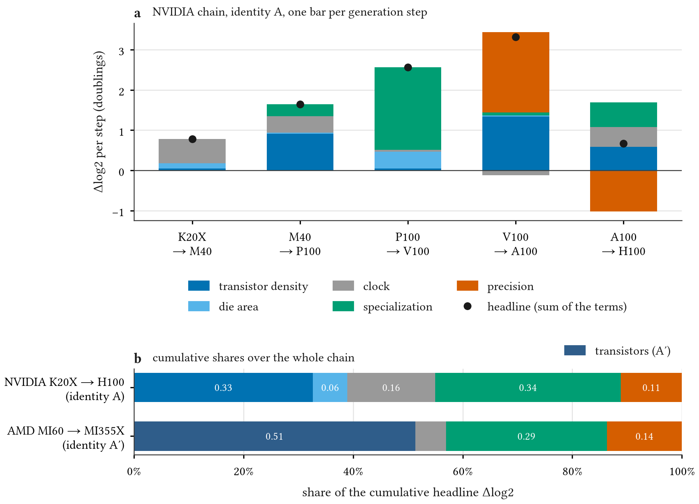

<p align="center"></p>

<h1 align="center">chipledger</h1>

[](https://github.com/thanatchon36/chipledger/actions/workflows/ci.yml)
[](https://doi.org/10.5281/zenodo.23763729)
[](LICENSE)
[](LICENSE-DATA)
[](STATUS.md)
[](PREREGISTRATION.md)

📄 **[Read the paper on the web](https://thanatchon36.github.io/chipledger/paper/)** ·
⬇️ **[Download the PDF](https://raw.githubusercontent.com/thanatchon36/chipledger/main/paper/chipledger.pdf)** ·
🤗 **[Dataset](https://huggingface.co/datasets/thanatchon36/chipledger)** ·
📊 **[Figures](results/figures/)** · 📚 **[Literature](docs/literature/REVIEW.md)** ·
🧾 **[Pre-registration](PREREGISTRATION.md)** · 🔀 **[Deviations](DEVIATIONS.md)** · 🔁 **[Reproduce](REPRODUCE.md)**

**Is Huang's Law Moore's Law? Decomposing a Decade of AI Accelerator Performance Growth, 2012–2026.** The peak
throughput of data-centre AI accelerators has grown far faster than Moore's law. `chipledger` asks how much of
that growth is Moore's law at all. For every product with public silicon data it computes an exact accounting
identity,

    log2 P = log2 density + log2 area + log2 clock + log2 specialization + log2 precision multiplier,

which splits headline throughput `P` into transistor density (Moore's law proper), total die area including
multi-die packaging, clock, reference-precision operations per transistor per cycle (matrix units), and the gain
from arithmetic narrower than 16 bits. The dataset carries a source URL, an access date and a confidence level for
every value; the design is pre-registered.

> Independent personal research. Public data only. Does not represent the views of any employer or institution.

## Result

<p align="center"></p>

From 2012 to 2022, **the headline peak throughput of AI accelerators doubled every 0.83 years** (95% CI
0.62–1.13) on the nine flagships that publish every field, and every 1.23 years over all 43 flagships to 2026.
**Transistor density, Moore's law in its scaling sense, supplied about a third of it**: on NVIDIA's chain from
K20X to H100, density carries 33% of the 501-fold gain, specialization at 16-bit precision (matrix units) 34%,
clock 16%, narrower formats 11% and die area 6%. Density's share is just below the pre-registered one-third
threshold; a 4% change in one endpoint's die area would cross it.

**NVIDIA's own account of the same decade adds up to the same total, about 500× without sparsity, but splits it
differently.** It credits 2.5× to process technology; transistor count times clock grew 30.5× over the same
products, because NVIDIA counts the extra transistors that a new node and a larger die make available as
architecture. The two accountings answer different questions; neither is wrong.

| pre-registered hypothesis | result |
|---|---|
| H1 headline doubles in ≤ 1.5 yr | **supported** (0.83 yr, CI 0.62–1.13) |
| H2 density doubles in ≥ 2.5 yr and is < 1/3 of the NVIDIA chain | **supported**, narrowly (2.76 yr; share 0.327) |
| H3 specialization + precision outweigh density | **falsified**: holds in the chain (0.45 vs 0.33), but the regression contrast is 0.09 doublings/yr, CI −0.10 to 0.31 |
| H4 more area and power after 2020 | not supported (one decomposable step; area fell) |
| H5 compute outgrows memory bandwidth | **supported** (0.71 doublings/yr faster, CI 0.40–1.07) |
| H6 measured MLPerf throughput grows more slowly than peak (exploratory) | supported on all four NVIDIA benchmarks |
| H7 transistors × clock grow ≥ 10×, K20X → H100 | **supported** (30.5×) |

These are vendor-published peaks, not delivered throughput. The decomposition sample is nine flagships and
NVIDIA-heavy, and it ends at H100: no vendor has published die area and clock for its flagship since 2022, so
the next decade's split cannot be measured from public documents unless that changes.

## What is here

| path | content |
|---|---|
| `data/accelerators.csv`, `data/sources.csv` | 79 accelerators from 14 vendors; 1,152 source rows, each with URL, access date and confidence |
| `data/mlperf.csv`, `data/nodes.csv` | per-accelerator MLPerf results; process-node volume-production years |
| `src/chipledger/` | schema and validation, the identities, estimators, tables, figures, paper builder |
| `results/` | `numbers.json`, `derived.csv`, tables, figures |
| `paper/` | paper source, PDF, bibliography, template |
| `docs/` | phase reports, decisions, literature review, dataset card, web paper |

The [Hugging Face dataset](https://huggingface.co/datasets/thanatchon36/chipledger) is built by
`scripts/build_hf_dataset.py`.

## Reproduce

```bash
uv sync
make all        # validate, derive, analyze, figures, paper, lint and tests; no network
```

`analyze` uses a fixed bootstrap seed and rebuilds `results/numbers.json` byte for byte. The paper build needs
pandoc and Typst and fills every number from `numbers.json`. See [`REPRODUCE.md`](REPRODUCE.md).

## Citation

See [`CITATION.cff`](CITATION.cff). Archived on Zenodo: [10.5281/zenodo.23763729](https://doi.org/10.5281/zenodo.23763729)
(concept DOI; it always resolves to the latest release).

## License

Code: [MIT](LICENSE). Data: [CC BY 4.0](LICENSE-DATA). Vendored fonts (Libertinus) are under the SIL OFL and
the Typst templates under pandoc's BSD licence; see `paper/fonts/OFL.txt` and `paper/templates/`.
