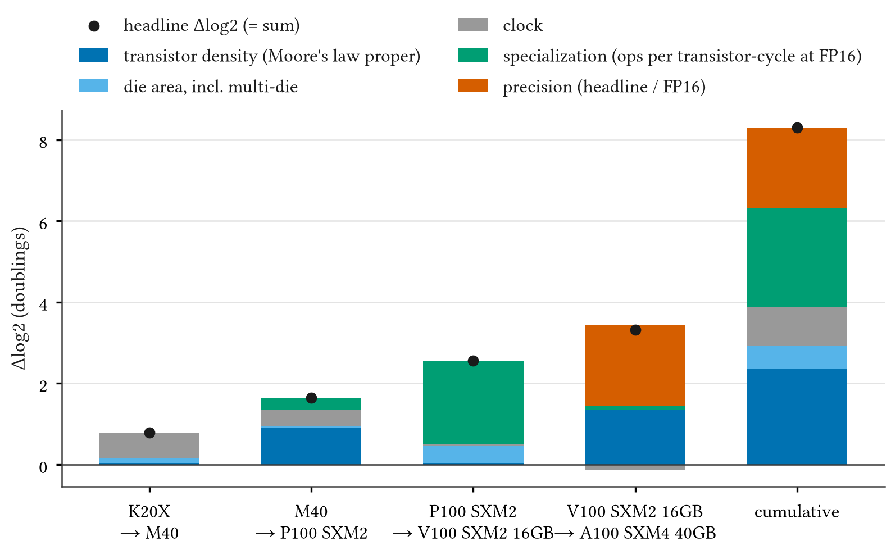
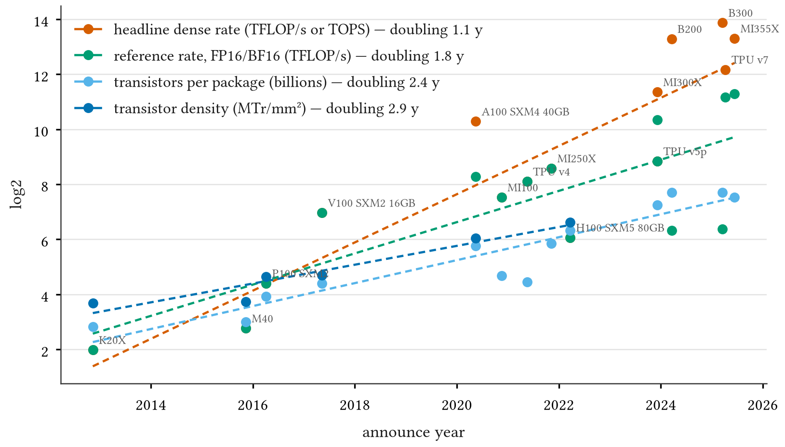

# Phase 1 report — feasibility

Sixteen products from three vendors were collected with full provenance; the identity, the chain decomposition
and the trend table were computed on them. Collected 2026-10-29. Nothing was published or sent to an external
service. All numbers below are provisional: they rest on five chips and will be recomputed in Phase 3.

## What was collected

| vendor | products | source rows | confidence |
|---|---|---|---|
| NVIDIA | K20X, M40, P100 SXM2, V100 SXM2 16GB, A100 SXM4 40GB, H100 SXM5 80GB, B200, B300 | 161 | all high |
| AMD | MI100, MI250X, MI300X, MI355X | 93 | all high |
| Google | TPU v4, v5p, v6e, v7 | 34 | all high |

Every value comes from a vendor document or a vendor-authored paper; `chipledger validate` passes with no errors
and ten warnings (flagships outside the decomposition sample). Source disagreements are in `data/conflicts.md`.
One value was removed after collection: TPU v4's `tdp_w` was the paper's maximum *measured* power, which is not
a TDP under §2.

**Checks.** (1) Eight values that drive the chain (A100 die area, boost clock and INT4 rate; P100 FP16 rate and
die area; M40 boost clock; MI300X FP16 rate and transistor count) were re-read from the cited documents by hand;
all eight appear verbatim. (2) All 71 values that overlap with Epoch AI's machine learning hardware database
(CC BY, downloaded 2026-10-29) were compared; 55 agree within 2 %, and the 16 that do not are date-convention
differences (Epoch AI uses release dates) or variant choices (B200 1,200 W vs 1,000 W, MI250X 560 W vs 500 W),
listed in `data/conflicts.md`. (3) The identity holds on every complete row; the largest residual is 3.6·10⁻¹⁵.

## The problem: the decomposition sample stops at A100

Only five products have all of N, A, f, W and a reference rate: K20X, M40, P100, V100 and A100 (2012–2020).

| gap | products | why |
|---|---|---|
| die area | B200, B300, all four AMD parts, TPU v4 | not published by the vendor; TPU v4 gives only "< 600 mm²" |
| boost clock | H100, B200, B300 | NVIDIA lists H100's clock as "Not finalized" and gives none for Blackwell |
| dense tensor rates | H100, B200, B300 (most formats) | nvidia.com lists tensor rates "with sparsity" only |
| everything silicon | TPU v5p, v6e, v7 | Google publishes no transistor count, area, clock or TDP |

The pre-registered fallback for a missing clock (§3) is TechPowerUp at medium confidence. TechPowerUp returned
HTTP 403 to every fetcher available in this session (three collectors and a direct check); WikiChip refused
connections. Epoch AI's database carries the TechPowerUp values for H100 (814 mm², 1,980 MHz boost, 989.5
dense FP16 tensor TFLOP/s) but not for Blackwell, MI300X or MI355X die areas.

The dense-rate gap also corrupts the throughput sample: with no dense tensor value, H100's headline and
reference fall back to FP32 (67 TFLOP/s), and B200's and B300's reference rates fall back to FP32. NVIDIA's
own GB200 and GB300 pages state "Dense is one-half sparse spec shown"; the collectors were told not to halve, so
they did not.

## Provisional signal (five NVIDIA chips, K20X → A100)

Cumulative, K20X → A100 SXM4 40GB, 7.5 years: 8.30 doublings of the headline rate (one doubling every 0.90
years). Shares of the cumulative Δlog2:

| term | Δlog2 | share |
|---|---|---|
| transistor density | 2.35 | 0.28 |
| die area | 0.58 | 0.07 |
| clock | 0.95 | 0.11 |
| specialization | 2.42 | 0.29 |
| precision | 2.00 | 0.24 |

Per step, the drivers differ sharply: K20X → M40 is mostly clock (K20X's 732 MHz has no boost); M40 → P100 is
mostly density (28 nm → 16 nm), and its specialization term includes the switch of reference from FP32
(K20X and M40 have no FP16 rate and are flagged, §2) to P100's FP16; P100 → V100 is 80 % specialization (tensor cores); V100 → A100 is density plus
precision, and the precision term is entirely A100's INT4 rate (1,248 TOPS against 312 TFLOP/s FP16). With the
pre-registered floating-point-only sensitivity, A100's precision term would be zero.

Trend fit on the same five chips (bootstrap 95 % intervals, 2,000 draws):

| series | slope (doublings/yr) | 95 % CI | doubling (yr) |
|---|---|---|---|
| headline | 1.18 | [0.46, 2.81] | 0.85 |
| density | 0.32 | [0.12, 0.64] | 3.09 |
| area | 0.09 | [0.04, 0.33] | 11.4 |
| clock | 0.13 | [−0.03, 0.31] | 7.8 |
| specialization | 0.38 | [0.04, 1.68] | 2.6 |
| precision | 0.26 | [0.00, 0.55] | 3.8 |

The term slopes add up to the headline slope exactly. The H3 contrast (specialization + precision − density)
is 0.31 doublings/yr with an interval of [−0.17, 1.25]: with five chips the trend estimator cannot separate
the terms. The H5 contrast (headline − memory bandwidth, 15 flagships) is 0.46 [0.30, 0.59], but that sample
contains the corrupted H100 headline and should not be read yet.

The ladder figure is rough: per-series fits on every flagship with the value, and the low H100, B200 and B300
points on the reference series are the FP32 fallbacks described above, not real FP16 rates.

## Surprises

1. Die area is the binding constraint, not clock. Vendors stopped publishing die area once packages went
   multi-die (Blackwell, MI300 onward); only the pre-2023 monolithic parts have it.
2. The precision term depends on whether INT4 counts. A100's headline is INT4; no later product in the sample publishes INT4,
   so the precision series jumps at A100 and then runs on FP8/FP4.
3. In every NVIDIA document collected that gives both, the sparse rate is exactly twice the dense rate; but only
   the Blackwell pages state the rule in writing.

## Recommendation for Gate 1

**Go, with the scope set by three decisions** (none changes a frozen hypothesis; each would be logged in
`DEVIATIONS.md`):

- **A. Dense from sparse.** Where the vendor's own page states that dense is one-half sparse (GB200, GB300), take
  dense = sparse / 2 at high confidence with the footnote quoted. For H100, a final dense rate from an NVIDIA
  document if one can be fetched (the Hopper blog has only the preliminary 1,000 / 2,000); otherwise Epoch AI
  at medium confidence.
- **B. Clock and area beyond vendor documents.** TechPowerUp is unreachable from here. Either (i) take Epoch AI's
  values at medium confidence where they trace to TechPowerUp, citing both; or (ii) the author saves the
  TechPowerUp pages from a browser into `data/raw/` and they are cited from there; or (iii) leave the products
  out and rely on the pre-registered clock-free identity.
- **C. Products with no die area.** Blackwell and MI300-class parts cannot enter identity A. They can enter a
  coarser transistor-count form (`N · f · spec · precision`), which keeps density and area merged; the full
  five-term chain would then end at H100 (2022), which is also H7's endpoint. Vendor conference papers (ISSCC,
  Hot Chips) may give AMD die areas and will be searched in Phase 2.

Without A and at least one of B(i)/B(ii), the decomposition answers the question for 2012–2020 only.
